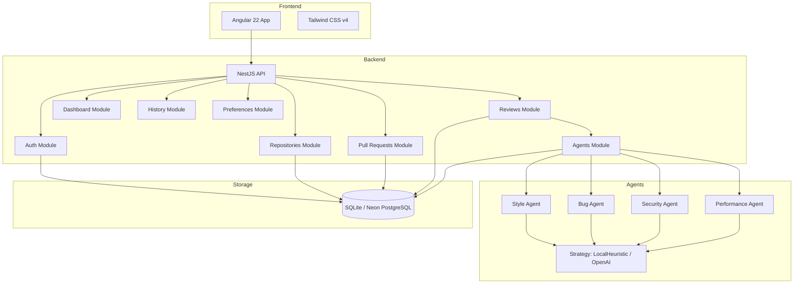

# Hermes Code Review Assistant

> AI-powered, multi-agent code review for pull requests — catching bugs, style issues, security vulnerabilities, and performance anti-patterns before they hit production.

## Features

- **Multi-Agent Code Review** — Four specialized AI agents analyze every PR diff for style, bugs, security, and performance issues
- **Local & AI-Powered Strategies** — Runs offline with heuristic rules, or optionally uses OpenAI for deeper analysis
- **Real-Time Streaming** — SSE-based progress streaming so you see each agent's findings as they complete
- **Pull Request Management** — Full CRUD for repositories and pull requests with diff viewing
- **Dashboard & Trends** — Visual overview of code quality scores over time with per-category breakdowns
- **User Preferences** — Configurable review severity thresholds and agent toggles per user
- **JWT Authentication** — Secure registration and login with token-based API access
- **TypeORM + SQL.js** — Zero-config SQLite storage with easy migration to PostgreSQL/Neon

## Tech Stack

| Layer | Technology |
|-------|-----------|
| **Frontend** | Angular 22 (zoneless), Tailwind CSS v4 |
| **Backend** | NestJS, TypeORM |
| **Database** | SQL.js (SQLite via sql.js) |
| **Auth** | JWT (bcryptjs + passport-jwt) |
| **AI** | Local heuristic rules + optional OpenAI |
| **Streaming** | SSE (Server-Sent Events) via RxJS |

## Architecture Overview



## Prerequisites

- **Node.js** v22+
- **npm** (comes with Node)

## Local Setup

```bash
# 1. Clone the repository
git clone <repo-url>
cd code-review-assistant

# 2. Install API dependencies
cd apps/api
npm install

# 3. Configure environment
cp .env.example .env
# Edit .env with your settings (defaults work for local dev)

# 4. Build and start the API
npm run build
npm start

# 5. In another terminal, install and start the web frontend
cd apps/web
npm install
npm run start
```

The API runs on **http://localhost:3000** and the frontend on **http://localhost:4200**. Swagger docs at **http://localhost:3000/api/docs**.

## Environment Variables

| Variable | Default | Description |
|----------|---------|-------------|
| `PORT` | `3000` | API server port |
| `JWT_SECRET` | `default-secret` | Secret key for JWT token signing |
| `DATABASE_URL` | `data/code-review.sqlite` | SQLite file path or PostgreSQL connection string |
| `OPENAI_API_KEY` | — | Optional: OpenAI API key for AI-powered analysis |

## Project Structure

```
├── apps/
│   ├── api/                          # NestJS backend
│   │   ├── src/
│   │   │   ├── auth/                 # Authentication (register, login, JWT)
│   │   │   ├── agents/               # Multi-agent review system
│   │   │   │   ├── agents/           # StyleAgent, BugAgent, SecurityAgent, PerformanceAgent
│   │   │   │   ├── strategies/       # LocalHeuristicStrategy, OpenAIStrategy
│   │   │   │   ├── types/            # Finding, AgentStatus interfaces
│   │   │   │   └── agent-coordinator.service.ts
│   │   │   ├── common/entities/      # TypeORM entity definitions
│   │   │   ├── dashboard/            # Dashboard stats and activity
│   │   │   ├── history/              # Review history and trends
│   │   │   ├── preferences/          # User preferences
│   │   │   ├── pull-requests/        # PR management
│   │   │   ├── repositories/         # Repository management
│   │   │   ├── reviews/              # Review orchestration
│   │   │   └── seed/                 # Database seeding
│   │   └── docs/                     # Project documentation
│   └── web/                          # Angular frontend
└── README.md
```

## Roadmap

- **v1.0** — Current: Multi-agent code review with local heuristics, PR management, dashboard
- **v1.1** — GitHub/GitLab webhook integration for automatic PR review
- **v1.2** — Custom rule definitions and pluggable agent modules
- **v2.0** — Team collaboration, shared dashboards, CI/CD pipeline integration
- **v2.1** — Support for additional languages (Rust, Go, Java) with language-specific rules
