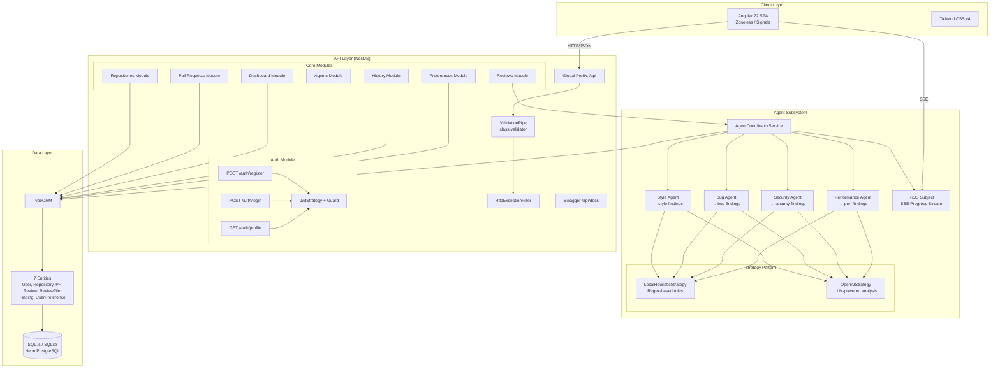
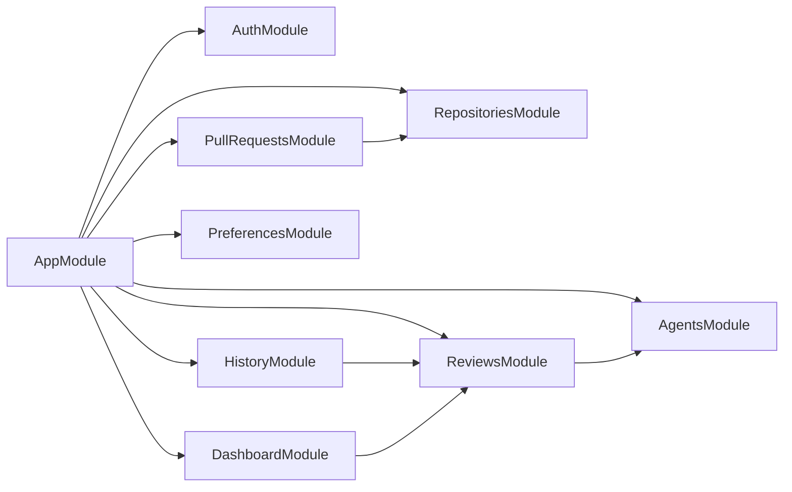

# System Architecture

## Overview

The Hermes Code Review Assistant follows a **layered monolith** architecture with a clear separation between the Angular frontend, NestJS backend, AI agent subsystem, and data persistence layer. The design prioritizes offline capability, extensibility, and real-time user feedback.

## High-Level Diagram



## Data Flow

### PR Review Flow

```
1. User creates a Pull Request (POST /api/repositories/:id/prs)
2. User triggers review (POST /api/prs/:id/reviews)
3. ReviewsService.runReview() calls AgentCoordinatorService.runReview()
4. Coordinator fetches ReviewFile records for the PR
5. For each file, runs ALL 4 agents sequentially:
   a. Emits "running" status via RxJS Subject (SSE stream)
   b. Agent calls its strategy's analyze(fileText, filePath, context)
   c. Strategy returns Finding[] interface objects
   d. Findings persisted to Finding entity via TypeORM
   e. Emits "completed" status with findingsCount
6. After all agents complete:
   a. Score calculated per category (100 - severity deductions)
   b. Overall score = average of 4 category scores
   c. Executive summary generated
   d. Review record updated with scores and summary
   e. "system/completed" event emitted
7. Frontend displays findings categorized by agent type
```

### Authentication Flow

```
1. User registers (POST /api/auth/register)
2. Password hashed with bcryptjs (salt rounds: 10)
3. User record created in DB
4. Default UserPreference record created
5. JWT token signed (7-day expiry) with sub, email, name
6. Token returned to client
7. Subsequent requests include Bearer token
8. JwtStrategy extracts user info from token
9. @UseGuards(JwtAuthGuard) protects endpoints
```

## Key Architectural Decisions

### Why NestJS?
- **Modular architecture** with dependency injection fits the multi-agent design
- **Decorator-based routing** keeps controllers clean
- **RxJS integration** enables natural SSE streaming
- **TypeORM integration** abstracts database differences

### Why Strategy Pattern for Agents?
Each agent (Style, Bug, Security, Performance) is a lightweight filter that delegates to a `CodeAnalysisStrategy`. This enables:
- **Local-first**: `LocalHeuristicStrategy` uses regex rules, works offline
- **AI-powered**: `OpenAIStrategy` can be swapped in when API key is configured
- **Extensible**: New strategies can be added without changing agents

### Why Fire-and-Forget for Async Review?
The `runAsyncReview` method runs without being awaited in `runReview()`:
- **Immediate response**: Returns reviewId + Observable immediately
- **SSE streaming**: Client subscribes to progress events via Server-Sent Events
- **No request timeout**: Long-running reviews don't block HTTP connections

## Module Dependency Graph



The `AppModule` imports all feature modules and configures the database connection. Feature modules are largely independent except `ReviewsModule` which depends on `AgentsModule` for the coordinator service.
