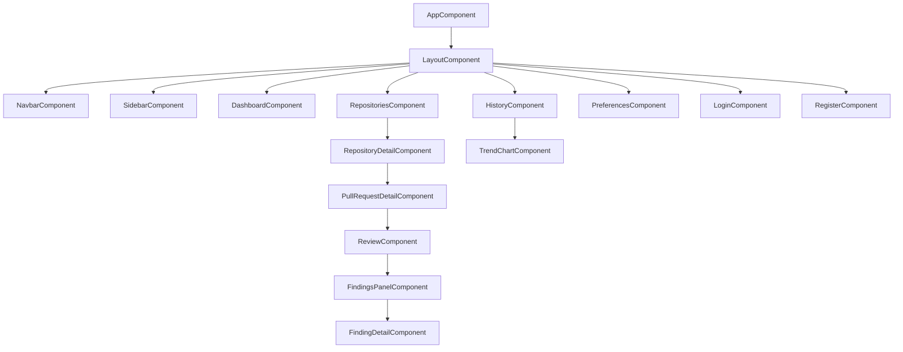

# Frontend Architecture

The frontend is an **Angular 22** application with **zoneless change detection**, Angular **Signals** for state management, and **Tailwind CSS v4** for styling.

---

## Signal Architecture

Angular's Signals provide reactive state management without Zone.js overhead. The application uses signals throughout for local component state and shared state.

### Where State Lives

| State | Location | Mechanism |
|-------|----------|-----------|
| **Auth state** (current user, token) | `AuthService` (providedIn: root) | `signal<User\|null>` + `effect` for localStorage sync |
| **Dashboard stats** | `DashboardComponent` | `signal<DashboardStats>` fetched via `httpResource` |
| **Repository list** | `RepositoriesComponent` | `signal<Repository[]>` with `computed` for filtering |
| **Current PR + diff** | `PullRequestDetailComponent` | `signal<PullRequest>` loaded by route param |
| **Review findings** | `ReviewComponent` | `signal<Finding[]>` populated from SSE stream |
| **Review progress** | `ReviewComponent` | `signal<AgentProgress>` updated via SSE events |
| **User preferences** | `PreferencesService` | `signal<UserPreference>` with PATCH on change |
| **Score trends** | `HistoryComponent` | `signal<Trend[]>` from `/history/trends` |
| **UI state** (modals, toasts) | Local component signals | `signal<boolean>`, `signal<string>` |

### Computed and Effect Usage

```
User signal → computed → filtered/transformed views
                           ↓
                    template binds with @let / @if / @for
                    
effect (when auth changes):
  ↳ sync token to localStorage
  ↳ redirect to login if unauthenticated

effect (when review status changes to 'completed'):
  ↳ reload findings and scores
  ↳ show notification/toast
```

### Zoneless Angular

The app runs with **zoneless change detection** (`provideExperimentalZonelessChangeDetection()`). Key implications:

- **No Zone.js monkey-patching**: Smaller bundle size, no change detection overhead
- **Explicit change detection**: Only signal changes and async operations trigger re-renders
- **`@let` syntax**: Template variables are reactive without `*ngIf`/`*ngFor` boilerplate
- **`httpResource`**: New in Angular 22, provides signal-based HTTP with built-in loading/error states
- **`afterRender` / `afterNextRender`**: Replace `ngAfterViewInit` for DOM-interaction code

---

## Component Tree



### Routing Structure

```typescript
const routes: Routes = [
  { path: '', redirectTo: '/dashboard', pathMatch: 'full' },
  { path: 'login', component: LoginComponent },
  { path: 'register', component: RegisterComponent },
  { path: 'dashboard', component: DashboardComponent, canActivate: [AuthGuard] },
  { path: 'repositories', component: RepositoriesComponent, canActivate: [AuthGuard] },
  { path: 'repositories/:id', component: RepositoryDetailComponent, canActivate: [AuthGuard] },
  { path: 'repositories/:repoId/prs/:prId', component: PullRequestDetailComponent, canActivate: [AuthGuard] },
  { path: 'history', component: HistoryComponent, canActivate: [AuthGuard] },
  { path: 'preferences', component: PreferencesComponent, canActivate: [AuthGuard] },
];
```

---

## Shared Component Library

The app uses a lightweight set of shared components built with Tailwind CSS v4:

| Component | Purpose |
|-----------|---------|
| `ButtonComponent` | Primary, secondary, danger, ghost variants |
| `CardComponent` | Content containers with optional header/footer |
| `BadgeComponent` | Status labels (severity: critical/major/minor/info) |
| `ScoreIndicatorComponent` | Circular progress-style score display (0-100) |
| `SeverityIconComponent` | Colored icon by severity level |
| `DiffViewerComponent` | Side-by-side or unified diff display |
| `AgentProgressBarComponent` | Horizontal progress bar for review stages |
| `LoadingSpinnerComponent` | Tailwind-based animated spinner |
| `ToastComponent` | Notification toasts |
| `ModalComponent` | Confirmation and detail modals |
| `PaginationComponent` | Page navigation for lists |
| `ChartComponent` | Line/bar charts for score trends |

### Tailwind CSS v4 Notes

- Uses `@import "tailwindcss"` (CSS-first config, no `tailwind.config.js`)
- Utility classes for all styling; no custom CSS (except animations)
- CSS layers for component overrides: `@layer components { ... }`
- Dark mode via `@variant dark (&:where(.dark, .dark *))` — toggled by user preference

---

## Key Dependencies

| Package | Purpose |
|---------|---------|
| `@angular/core` (22) | Framework with signals, zoneless |
| `@angular/router` | Client-side routing |
| `@angular/common/http` | HTTP client with interceptors |
| `tailwindcss` (v4) | Utility-first CSS framework |
| `@ngrx/signals` | Optional: advanced signal store patterns |
| `chart.js` | (Planned) Score trend visualizations |

---

## State Flow Example: Running a Review

```
1. User clicks "Run Review" button on PR detail page
2. ReviewComponent POSTs to /api/prs/:prId/reviews
3. Response contains reviewId + Observable reference
4. Component creates EventSource to /api/prs/:prId/reviews/stream
5. SSE events emitted on each agent progress:
   → signal.set({ agentName: 'style', status: 'running' })
   → computed re-evaluates → template shows progress
   → signal.set({ agentName: 'style', status: 'completed', findingsCount: 3 })
6. On 'system/completed':
   → Component calls GET /api/prs/:prId/reviews/summary
   → Populates findings signal
   → Template renders results
7. Component cleans up EventSource on destroy
```
